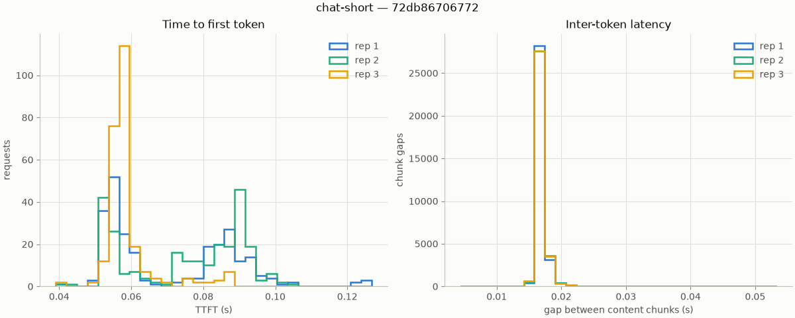

# Results

Every table here is generated from raw per-request data committed under
`results/<run_id>/`, where `<run_id>` is the first 12 hex chars of the run's
SHA-256 config fingerprint plus a UTC timestamp. To re-derive any table or
plot from the committed data:

```sh
uv run llm-bench analyze results/<run_id> --plot /tmp/latency.png
```

The fingerprint covers model (id + revision), engine (name, version, image
digest, every serving flag), quantization, hardware, workload (including a
content hash of the prompt corpus), and load-generator settings. Two runs with
the same fingerprint are directly comparable; see `docs/metrics.md` for metric
definitions and measurement methodology.

---

## Phase 1 — vLLM bf16 baseline

**Run `72db86706772-20261023T193927Z`** · fingerprint
`72db86706772f0a2ed6df39e4848e3b0e643988a6f904aa06c12e1f8fd38333d` ·
measured 2026-10-23

One engine, one model, one workload: the calibration point every later phase
compares against.

| | |
|---|---|
| Model | `meta-llama/Llama-3.1-8B-Instruct` @ `0e9e39f249a16976918f6564b8830bc894c89659` |
| Engine | vLLM 0.32.0, image `vllm/vllm-openai@sha256:befccf0e7e4089aa23926bb6f887a85c0d46c2a99e6de5c5ffdf5cb7957c5b34` (= `v0.32.0`) |
| Precision | bf16 (vLLM `dtype auto`; no quantization) |
| Serving flags | `--max-model-len 4096 --no-enable-prefix-caching` — every other flag at engine default; justifications in `docs/phase1-runbook.md` |
| Hardware | 1× RTX 4090 24 GB (driver 595.91.07, CUDA 13.2), RunPod secure cloud |
| Workload | `chat-short`: 72-prompt corpus, 128 output tokens fixed via `ignore_eos`, temperature 0, concurrency 8 |
| Shape | 3 reps × 256 measured requests, 16 warmup requests discarded per rep, **0 errors in 768 requests** |

### Latency and throughput (mean ± population std across 3 reps)

| Metric | Mean | Std | Min | Max |
|---|---:|---:|---:|---:|
| TTFT p50 (s) | 0.0661 | 0.0096 | 0.0575 | 0.0794 |
| TTFT p90 (s) | 0.0830 | 0.0134 | 0.0640 | 0.0926 |
| TTFT p99 (s) | 0.1035 | 0.0156 | 0.0861 | 0.1239 |
| E2E p50 (s) | 2.239 | 0.013 | 2.221 | 2.253 |
| E2E p99 (s) | 2.280 | 0.016 | 2.262 | 2.301 |
| TPOT p50 (s) | 0.01709 | 0.00004 | 0.01705 | 0.01714 |
| ITL p50 (s) | 0.01703 | 0.00003 | 0.01700 | 0.01706 |
| Output tokens/s | 456.3 | 2.2 | 453.8 | 459.1 |
| Requests/s | 3.565 | 0.017 | 3.545 | 3.587 |



### Why these numbers are believable

- **Internal consistency.** TTFT p50 + 127 × ITL p50 = 0.066 + 2.163 ≈ 2.23 s,
  matching the independently measured E2E p50. Token accounting is exact:
  256 × 128 tokens ÷ 71.9 s window = 456.1 tok/s, the reported throughput.
- **Variance lands where it should.** ITL is metronomic across reps
  (σ = 26 µs — fixed-length greedy decoding under CUDA graphs), while TTFT
  wobbles ±15% (prefill is scheduling-sensitive). The reverse pattern would
  indicate a harness bug.
- **Evidence bundle.** `results/<run_id>/` carries the manifest, all 816 raw
  per-request records (warmup labeled, never silently dropped), `hw.json`,
  a 1 Hz GPU utilization/memory log spanning idle → model load → saturation →
  idle, the vLLM startup log (proving the exact serving flags), and the
  benchmark console output.
- **Fingerprint integrity.** Recomputing the SHA-256 over the committed
  manifest reproduces the stored fingerprint and the run-directory name.

### Caveats

- "Tokens" in streaming metrics are SSE content chunks; totals are
  cross-checked against the server's `usage.completion_tokens` (see
  `docs/metrics.md`). For this run the two agree exactly.
- Prefix caching is disabled because the 72-prompt corpus cycles over 256
  requests; with caching on, repeated prompts would measure vLLM's cache
  rather than prefill (DECISIONS 0016). Cache-friendly workloads are a
  deliberate future measurement, not an accident.
- Single workload at a single concurrency. The throughput-vs-latency curve
  (concurrency sweep) is Phase 5; engine comparison starts in Phase 2.
- Secure-cloud host (community stock was dry on run day). Same silicon as the
  planned community tier; per-datacenter variance is unquantified until a
  repeat run on different hosts.
